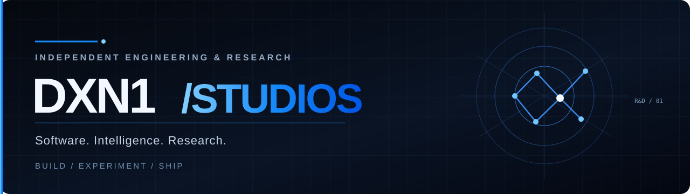

 

# DXN1-STUDIOS

### Independent research. Real engineering. Open exploration.

**Physics** &nbsp;·&nbsp; **Astrophysics** &nbsp;·&nbsp; **Artificial Intelligence** &nbsp;·&nbsp; **Open Source**

We explore difficult scientific and engineering questions, turn ideas into experiments, and build software that people can actually use.

 

&nbsp;

&nbsp;

  

## What we do

<table>
<tr>
<td width="50%" valign="top">

### 🌌 Physics & Astrophysics

We investigate questions in theoretical physics, cosmology, gravitation, and astrophysics through mathematics, models, and computational analysis.

</td>
<td width="50%" valign="top">

### 🧠 AI Research

We explore language-model architectures, efficient computation, evaluation methods, and experimental approaches to intelligent systems.

</td>
</tr>
<tr>
<td valign="top">

### ⚙️ Software Engineering

We build open-source tools, backend systems, developer infrastructure, and software that supports ambitious technical work.

</td>
<td valign="top">

### 🧪 Experimental Development

We turn concepts into prototypes, simulations, and reproducible experiments — including work where the answer is still unknown.

</td>
</tr>
</table>

## Research & open work

A few examples of the areas we explore:

- **[LTB cosmology and redshift drift](https://github.com/dxn111/ltb-decaying-drift)** — a computational physics preprint with equations, numerical models, and reproduction code.
- **[Causal Packet Networks](https://github.com/dxn111/causal-packet-networks)** — an experimental AI architecture proposal, with performance claims left open for testing.

Some research is currently published through the founder's GitHub account. Research proposals and preprints are not presented as proven or peer-reviewed results.

 

**QUESTION EVERYTHING. BUILD SOMETHING.**

© 2026 DXN1-STUDIOS · Independent Research & Engineering

